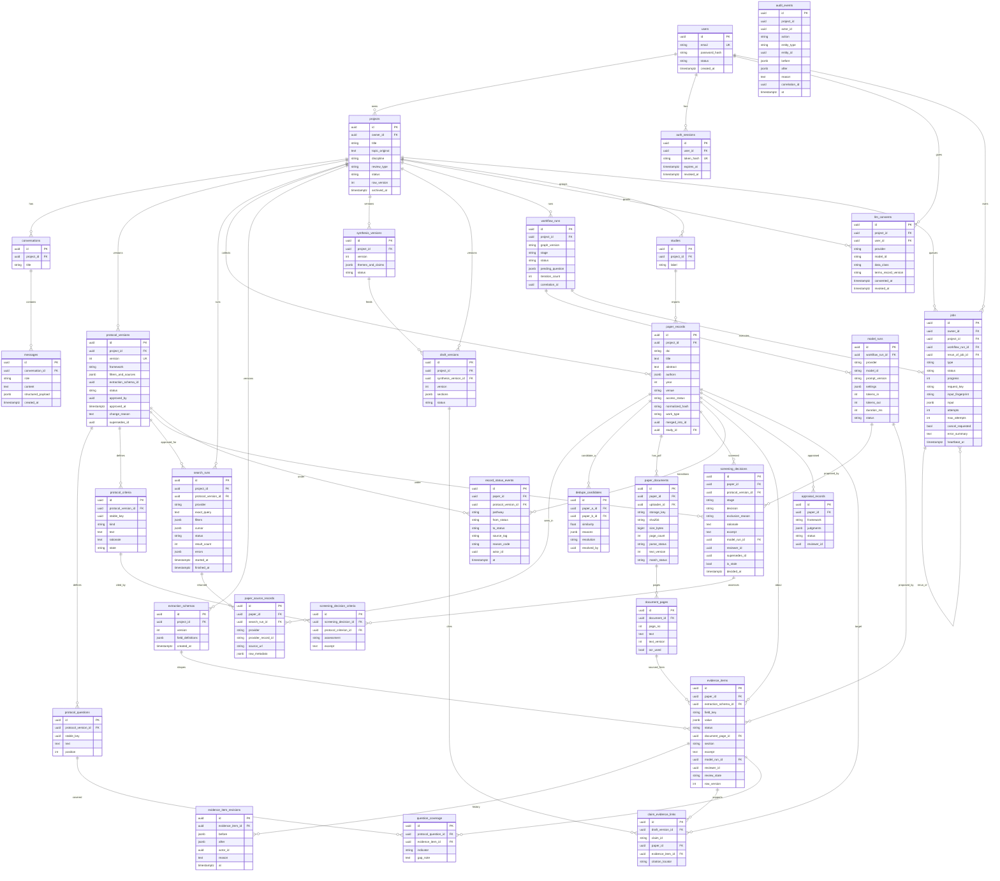

# Database entity relationship diagram

Spec §8 tables plus additions marked ★ (rationale in ADR-0001 §4). Only key columns are shown. All PKs are UUIDs. Every project-scoped table carries `project_id` (directly or via parent) so ownership can be enforced server-side.

> **Implemented by migration `0001_baseline` (Phase 1):** `users`, `auth_sessions`, `projects`, `audit_events`, `jobs`.
> Every other table is design intent for a later phase. `password_reset_tokens` was **removed** (password recovery deferred, ADR amendment A8).
> `llm_consents` (A4) and `studies` + PRISMA fields (A6) are **new** since Phase 0.
>
> Mermaid source below was **not rendered** in Phase 0 (no renderer available offline); structural consistency was checked by script (see report).

## Key constraints and indexes (to be implemented with each phase's migration)

| Table | Constraint / index | Why |
|---|---|---|
| `users` | unique `lower(email)` | account identity |
| `protocol_versions` | unique `(project_id, version)`; approved rows immutable (trigger or service guard + test) | spec §3.2, rule 16 |
| `search_runs` | index `(project_id, provider, started_at)` | reproducibility listing |
| `paper_records` | index `(project_id, doi)`; partial unique `(project_id, lower(doi)) WHERE doi IS NOT NULL AND merged_into_id IS NULL`; index `(project_id, normalized_hash)` | dedupe, filters |
| `paper_source_records` | unique `(search_run_id, provider, provider_record_id)` | idempotent retry |
| `paper_documents` | unique `(paper_id, sha256)` | no duplicate uploads |
| `document_pages` | unique `(document_id, page_no, text_version)` | provenance |
| `screening_decisions` | index `(paper_id, stage, protocol_version_id)`; CHECK `stage='full_text' AND decision='exclude' ⇒ exclusion_reason IS NOT NULL` | spec §3.6 |
| `evidence_items` | unique `(paper_id, extraction_schema_id, field_key)`; CHECK `status='extracted' ⇒ excerpt IS NOT NULL AND document_page_id IS NOT NULL` (with explicit exceptions enumerated in code) | provenance (rule 9) |
| `screening_decision_criteria` | unique `(screening_decision_id, protocol_criterion_id)`; `assessment` in `met\|not_met\|unclear` | criterion-level rationale (spec §3.6) |
| `jobs` | partial unique `(owner_id, request_key) WHERE request_key IS NOT NULL`; partial unique `(owner_id, type, COALESCE(project_id, zero-uuid), input_fingerprint) WHERE status IN ('queued','running')` | replay-safe submission **and** no duplicate in-flight work, **without** blocking legitimate reruns (A5) |
| `audit_events` | indexes `(project_id, at)`, `(actor_id, at)`; **no foreign keys**; BEFORE UPDATE/DELETE row trigger and BEFORE TRUNCATE statement trigger raise | append-only for every DB role; events outlive deleted projects |
| editable rows | `row_version` optimistic concurrency (`projects`, `protocol_versions` draft, `evidence_items`, `draft_versions`, `screening_decisions` via supersession) | spec §8 |

## Notes
- `paper_records.merged_into_id`: merges are reversible pointers, never deletes, so PRISMA "duplicates removed" counts remain derivable.
- `screening_decisions` are append-only; an override is a new row with `supersedes_id`.
- Large text (`document_pages.text`) is isolated from hot tables; raw PDFs live in object storage, referenced by `storage_key`.
- **Deletion/retention (decided in Phase 1):** deleting a project hard-deletes the project and all dependent rows (cascade) and, in later phases, purges its stored objects. `audit_events` are retained (ids, action names, timestamps, actor) and contain **no free-text user content** (titles/topics are never written to the log; only changed field *names*). Account deletion is not implemented yet (`users` FKs are RESTRICT) and is listed as a limitation.
