# Database entity relationship diagram

Spec §8 tables plus additions marked ★ (rationale in ADR-0001 §4). Only key columns are shown. All PKs are UUIDs. Every project-scoped table carries `project_id` (directly or via parent) so ownership can be enforced server-side.

> **Implemented by migration `0001_baseline` (Phase 1):** `users`, `auth_sessions`, `projects`, `audit_events`, `jobs`.
> Every other table is design intent for a later phase. `password_reset_tokens` was **removed** (password recovery deferred, ADR amendment A8).
> `llm_consents` (A4) and `studies` + PRISMA fields (A6) are **new** since Phase 0.
>
> Mermaid source below was **not rendered** in Phase 0 (no renderer available offline); structural consistency was checked by script (see report).

```mermaid
erDiagram
  users ||--o{ projects : owns
  users ||--o{ auth_sessions : has
  projects ||--o{ conversations : has
  conversations ||--o{ messages : contains
  projects ||--o{ protocol_versions : versions
  protocol_versions ||--o{ protocol_questions : defines
  protocol_versions ||--o{ protocol_criteria : defines
  projects ||--o{ search_runs : runs
  protocol_versions ||--o{ search_runs : approved_for
  projects ||--o{ paper_records : collects
  paper_records ||--o{ paper_source_records : seen_in
  search_runs ||--o{ paper_source_records : returned
  paper_records ||--o{ dedupe_candidates : candidate_a
  paper_records ||--o{ paper_documents : has_pdf
  paper_documents ||--o{ document_pages : pages
  jobs |o--o{ paper_documents : reads
  paper_records ||--o{ screening_decisions : screened
  protocol_versions ||--o{ screening_decisions : under
  screening_decisions ||--o{ screening_decision_criteria : assesses
  protocol_criteria ||--o{ screening_decision_criteria : cited_by
  model_runs ||--o{ screening_decisions : proposed_by
  paper_records ||--o{ record_status_events : transitions
  protocol_versions ||--o{ record_status_events : under
  projects ||--o{ extraction_schemas : versions
  extraction_schemas ||--o{ evidence_items : shapes
  paper_records ||--o{ evidence_items : about
  document_pages ||--o{ evidence_items : sourced_from
  evidence_items ||--o{ evidence_item_revisions : history
  model_runs ||--o{ evidence_items : proposed_by
  projects ||--o{ evidence_outputs : exports
  extraction_schemas ||--o{ evidence_outputs : from
  evidence_outputs ||--o{ evidence_output_items : used
  evidence_items ||--o{ evidence_output_items : used_in
  paper_records ||--o{ appraisal_records : appraised
  projects ||--o{ appraisal_records : appraises
  appraisal_records ||--o{ appraisal_revisions : history
  extraction_schemas ||--o{ synthesis_versions : from
  evidence_outputs ||--o{ synthesis_versions : recorded_as
  projects ||--o{ synthesis_versions : versions
  projects ||--o{ draft_versions : versions
  synthesis_versions ||--o{ draft_versions : feeds
  draft_versions ||--o{ claim_evidence_links : cites
  projects ||--o{ report_exports : exports
  draft_versions ||--o{ report_exports : exported_as
  projects ||--o{ pipeline_runs : orchestrates
  pipeline_runs ||--o{ pipeline_events : history
  projects ||--o{ stage_invalidations : flags
  pipeline_runs ||--o{ stage_invalidations : raised_by
  paper_records ||--o{ claim_evidence_links : target
  evidence_items ||--o{ claim_evidence_links : supports
  protocol_questions ||--o{ question_coverage : covered
  evidence_items ||--o{ question_coverage : supports
  projects ||--o{ workflow_runs : runs
  projects ||--o{ llm_consents : grants
  users ||--o{ llm_consents : gives
  projects ||--o{ studies : groups
  studies ||--o{ paper_records : reports
  workflow_runs ||--o{ model_runs : calls
  users ||--o{ jobs : owns
  projects ||--o{ jobs : queues
  jobs ||--o{ jobs : rerun_of
  workflow_runs ||--o{ jobs : executes

  users {
    uuid id PK
    string email UK
    string password_hash
    string status
    timestamptz created_at
  }
  auth_sessions {
    uuid id PK
    uuid user_id FK
    string token_hash UK
    timestamptz expires_at
    timestamptz revoked_at
  }
  projects {
    uuid id PK
    uuid owner_id FK
    string title
    text topic_original
    string discipline
    string review_type
    string status
    int row_version
    timestamptz archived_at
  }
  conversations {
    uuid id PK
    uuid project_id FK
    uuid created_by FK
    string title
    string title_source
    int message_count
    int row_version
    timestamptz updated_at
    timestamptz last_message_at
  }
  messages {
    uuid id PK
    uuid conversation_id FK
    int seq UK
    uuid author_id FK
    string role
    text content
    jsonb payload
    uuid client_message_id UK
    timestamptz created_at
  }
  protocol_versions {
    uuid id PK
    uuid project_id FK
    int version UK
    string framework
    jsonb filters_and_sources
    uuid extraction_schema_id
    string status
    uuid approved_by
    timestamptz approved_at
    text change_reason
    uuid supersedes_id
  }
  protocol_questions {
    uuid id PK
    uuid protocol_version_id FK
    uuid stable_key
    text text
    int position
  }
  protocol_criteria {
    uuid id PK
    uuid protocol_version_id FK
    uuid stable_key
    string kind
    text text
    text rationale
    string state
  }
  search_runs {
    uuid id PK
    uuid project_id FK
    uuid protocol_version_id FK
    string provider
    text exact_query
    jsonb filters
    jsonb cursor
    string status
    int result_count
    jsonb errors
    timestamptz started_at
    timestamptz finished_at
  }
  paper_records {
    uuid id PK
    uuid project_id FK
    string doi
    text title
    text abstract
    jsonb authors
    int year
    string venue
    string access_status
    string normalized_hash
    string work_type
    uuid merged_into_id
    uuid study_id FK
  }
  paper_source_records {
    uuid id PK
    uuid paper_id FK
    uuid search_run_id FK
    string provider
    string provider_record_id
    string source_url
    jsonb raw_metadata
  }
  dedupe_candidates {
    uuid id PK
    uuid paper_a_id FK
    uuid paper_b_id FK
    float similarity
    jsonb reasons
    string resolution
    uuid resolved_by
  }
  paper_documents {
    uuid id PK
    uuid paper_id FK
    uuid uploader_id FK
    string storage_key
    string sha256
    bigint size_bytes
    int page_count
    string parse_status
    int text_version
    string match_status
  }
  document_pages {
    uuid id PK
    uuid document_id FK
    int page_no
    text text
    int text_version
    bool ocr_used
  }
  screening_decisions {
    uuid id PK
    uuid paper_id FK
    uuid protocol_version_id FK
    string stage
    string decision
    string exclusion_reason
    text rationale
    text excerpt
    uuid model_run_id FK
    uuid reviewer_id
    uuid supersedes_id
    bool is_stale
    timestamptz decided_at
  }
  screening_decision_criteria {
    uuid id PK
    uuid screening_decision_id FK
    uuid protocol_criterion_id FK
    string assessment
    text excerpt
  }
  record_status_events {
    uuid id PK
    uuid paper_id FK
    uuid protocol_version_id FK
    string pathway
    string from_status
    string to_status
    string source_tag
    string reason_code
    uuid actor_id
    timestamptz at
  }
  extraction_schemas {
    uuid id PK
    uuid project_id FK
    int version
    jsonb field_definitions
    timestamptz created_at
  }
  evidence_items {
    uuid id PK
    uuid project_id FK
    uuid paper_id FK
    uuid extraction_schema_id FK
    string field_key
    jsonb value
    string status
    uuid document_page_id FK
    text excerpt
    uuid model_run_id FK
    uuid reviewer_id FK
    string origin
    string review_status
    string extraction_version
    jsonb pages_inspected
    jsonb validation
    int row_version
  }
  evidence_item_revisions {
    uuid id PK
    uuid project_id FK
    uuid evidence_item_id FK
    int revision
    string action
    jsonb before
    jsonb after
    uuid actor_id
    uuid model_run_id FK
    text reason
    timestamptz at
  }
  evidence_outputs {
    uuid id PK
    uuid project_id FK
    uuid extraction_schema_id FK
    string kind
    uuid created_by
    int item_count
    timestamptz created_at
  }
  evidence_output_items {
    uuid id PK
    uuid evidence_output_id FK
    uuid evidence_item_id FK
    int revision
  }
  appraisal_records {
    uuid id PK
    uuid project_id FK
    uuid paper_id FK
    string framework_key
    string framework_version
    string status
    jsonb answers
    string suggested_overall
    string overall_judgement
    text overall_justification
    uuid reviewer_id FK
    int row_version
  }
  appraisal_revisions {
    uuid id PK
    uuid project_id FK
    uuid appraisal_record_id FK
    int revision
    string action
    jsonb before
    jsonb after
    uuid actor_id
    uuid model_run_id FK
    text reason
    timestamptz at
  }
  synthesis_versions {
    uuid id PK
    uuid project_id FK
    uuid extraction_schema_id FK
    int version
    string status
    jsonb scope
    jsonb statements
    jsonb meta_analysis
    uuid evidence_output_id FK
    uuid model_run_id FK
    int row_version
  }
  draft_versions {
    uuid id PK
    uuid project_id FK
    int version
    string status
    text title
    jsonb sections
    jsonb references
    jsonb review_state
    jsonb validation
    uuid synthesis_version_id FK
    uuid protocol_version_id FK
    uuid extraction_schema_id FK
    uuid supersedes_id FK
    text change_summary
    timestamptz created_at
  }
  claim_evidence_links {
    uuid id PK
    uuid draft_version_id FK
    string claim_id
    uuid paper_id FK
    uuid evidence_item_id FK
    int evidence_revision
    string citation_key
    string citation_locator
  }
  report_exports {
    uuid id PK
    uuid project_id FK
    uuid draft_version_id FK
    string format
    string filename
    string sha256
    int byte_size
    jsonb review_state
    jsonb validation_summary
    bool data_changed_since_draft
    timestamptz created_at
  }
  pipeline_runs {
    uuid id PK
    uuid project_id FK
    uuid thread_id
    string graph_version
    string status
    string stage
    string start_stage
    jsonb autonomy
    jsonb pending
    jsonb outputs
    jsonb counters
    uuid protocol_version_id FK
    uuid supersedes_id FK
    text rerun_reason
    uuid created_by FK
    int row_version
  }
  pipeline_events {
    uuid id PK
    uuid run_id FK
    uuid project_id FK
    string kind
    string stage
    jsonb payload
    uuid actor_id
    timestamptz created_at
  }
  stage_invalidations {
    uuid id PK
    uuid project_id FK
    uuid pipeline_run_id FK
    string stage
    string cause
    jsonb detail
    string status
    text resolution
    timestamptz resolved_at
  }
  question_coverage {
    uuid id PK
    uuid protocol_question_id FK
    uuid evidence_item_id FK
    string indicator
    text gap_note
  }
  llm_consents {
    uuid id PK
    uuid project_id FK
    uuid user_id FK
    string provider
    string model
    string data_class
    string terms_record_version
    string notice_version
    timestamptz consented_at
    timestamptz revoked_at
  }
  studies {
    uuid id PK
    uuid project_id FK
    string label
  }
  workflow_runs {
    uuid id PK
    uuid project_id FK
    string graph_version
    string stage
    string status
    jsonb pending_question
    int iteration_count
    uuid correlation_id
  }
  model_runs {
    uuid id PK
    uuid workflow_run_id FK
    string provider
    string model_id
    string prompt_version
    jsonb settings
    int tokens_in
    int tokens_out
    int duration_ms
    string status
  }
  jobs {
    uuid id PK
    uuid owner_id FK
    uuid project_id FK
    uuid workflow_run_id FK
    uuid rerun_of_job_id FK
    string type
    string status
    int progress
    string request_key
    string input_fingerprint
    jsonb input
    int attempts
    int max_attempts
    bool cancel_requested
    text error_summary
    timestamptz heartbeat_at
  }
  audit_events {
    uuid id PK
    uuid project_id
    uuid actor_id
    string action
    string entity_type
    uuid entity_id
    jsonb before
    jsonb after
    text reason
    uuid correlation_id
    string actor_process
    timestamptz at
  }
```

> **Phase 14 (`0012_audit_hardening`):** `audit_events.actor_process` names the system process (e.g. `worker:system.purge_documents`, `cli:set-password`) when `actor_id` is null; new index `ix_audit_events_entity_at (entity_id, at)` serves the account activity view.

## Key constraints and indexes (to be implemented with each phase's migration)

| Table | Constraint / index | Why |
|---|---|---|
| `users` | unique `lower(email)` | account identity |
| `protocol_versions` | unique `(project_id, version)`; approved rows immutable (trigger or service guard + test) | spec §3.2, rule 16 |
| `search_runs` | index `(project_id, provider, started_at)` | reproducibility listing |
| `paper_records` | index `(project_id, doi)`; partial unique `(project_id, lower(doi)) WHERE doi IS NOT NULL AND merged_into_id IS NULL`; index `(project_id, normalized_hash)` | dedupe, filters |
| `paper_source_records` | unique `(search_run_id, provider, provider_record_id)` | idempotent retry |
| `paper_documents` | unique `(paper_id, sha256)` | no duplicate uploads |
| `document_pages` | unique `(document_id, page_no, text_version)` | provenance |
| `screening_decisions` | index `(paper_id, stage, protocol_version_id)`; CHECK `stage='full_text' AND decision='exclude' ⇒ exclusion_reason IS NOT NULL` | spec §3.6 |
| `evidence_items` | unique `(paper_id, extraction_schema_id, field_key)`; CHECK `status='found' ⇒ value IS NOT NULL`; excerpt must occur in the cited page of a document linked to the paper (service layer; AI quotes are located and stored as the exact source substring) | provenance (rule 9) |
| `evidence_item_revisions` | unique `(evidence_item_id, revision)`; append-only trigger (deletion only by cascade from the item) | Phase 9 history |
| `evidence_output_items` | unique `(evidence_output_id, evidence_item_id)`; `revision` < item `row_version` ⇒ output is stale | Phase 9 lineage |
| `appraisal_records` | unique `(paper_id, framework_key)`; reviewer judgements and AI suggestions stored apart per domain; approval requires every domain judged by a reviewer | Phase 10 |
| `appraisal_revisions` | unique `(appraisal_record_id, revision)`; append-only trigger | Phase 10 history |
| `synthesis_versions` | unique `(project_id, version)`; one draft per project (service); accepted versions immutable; statements cite evidence item + revision, certainty computed by rules | Phase 10 |
| `draft_versions` | unique `(project_id, version)`; immutable versions (every edit = new version, previous `superseded`); tables only from stored data | Phase 11 |
| `claim_evidence_links` | FK to `paper_records` (every citation is a stored record) and optional `evidence_items` + revision | Phase 11 |
| `report_exports` | format CHECK; SHA-256 of delivered bytes + review state at export | Phase 11 |
| `pipeline_runs` | partial unique `(project_id) WHERE status in (queued,running,waiting,paused)`: one active run; reruns are new rows (`supersedes_id`) | Phase 13 |
| `pipeline_events` | append-only trigger (deletion only by cascade) | Phase 13 audit |
| `stage_invalidations` | never deletes outputs; `open → resolved/dismissed` with a recorded resolution | Phase 13 |
| `llm_consents` | partial unique `(project_id, provider, model, data_class) WHERE revoked_at IS NULL` | gate G3 |
| `screening_decision_criteria` | unique `(screening_decision_id, protocol_criterion_id)`; `assessment` in `met\|not_met\|unclear` | criterion-level rationale (spec §3.6) |
| `jobs` | partial unique `(owner_id, request_key) WHERE request_key IS NOT NULL`; partial unique `(owner_id, type, COALESCE(project_id, zero-uuid), input_fingerprint) WHERE status IN ('queued','running')` | replay-safe submission **and** no duplicate in-flight work, **without** blocking legitimate reruns (A5) |
| `audit_events` | indexes `(project_id, at)`, `(actor_id, at)`; **no foreign keys**; BEFORE UPDATE/DELETE row trigger and BEFORE TRUNCATE statement trigger raise | append-only for every DB role; events outlive deleted projects |
| editable rows | `row_version` optimistic concurrency (`projects`, `protocol_versions` draft, `evidence_items`, `draft_versions`, `screening_decisions` via supersession) | spec §8 |

## Notes
- `paper_records.merged_into_id`: merges are reversible pointers, never deletes, so PRISMA "duplicates removed" counts remain derivable.
- `screening_decisions` are append-only; an override is a new row with `supersedes_id`.
- Large text (`document_pages.text`) is isolated from hot tables; raw PDFs live in object storage, referenced by `storage_key`.
- **Deletion/retention (decided in Phase 1):** deleting a project hard-deletes the project and all dependent rows (cascade) and, in later phases, purges its stored objects. `audit_events` are retained (ids, action names, timestamps, actor) and contain **no free-text user content** (titles/topics are never written to the log; only changed field *names*). Account deletion is not implemented yet (`users` FKs are RESTRICT) and is listed as a limitation.

### Phase 2 notes (implemented in migration `0002_conversations`)

- `conversations` have no owner column: ownership is inherited from `projects.owner_id`, so it cannot drift.
  Every conversation lookup is scoped by `project_id` after the owner-scoped project lookup.
- `messages.seq` is unique per conversation and gap-free (assigned under a row lock on the conversation);
  `(conversation_id, client_message_id)` is unique where present, so a retried send is stored once.
- `messages.payload` (named `structured_payload` in the Phase 0 sketch) is reserved for approval cards and citations.
- `created_by` / `author_id` are `ON DELETE SET NULL`; deleting a conversation cascades to its messages, and
  deleting a project cascades to its conversations.

### Phase 3 notes (implemented in migration `0003_protocol_workflow`)

- `protocol_versions`: one row per version; partial unique indexes allow **one draft and one approved** version per
  project. Columns beyond the Phase 0 sketch: `framework_source`, `framework_rationale` (the advisor's explanation as
  shown), the scope fields (`date_from`, `date_to`, `languages`, `study_designs`, `sources`), plans, `content_hash`
  (SHA-256 of the canonical approved content), `impact` (diff and affected stages vs the previous approval), and
  `superseded_at`. `filters_and_sources` and `extraction_schema_id` from the sketch are replaced by these explicit
  columns; the extraction schema link arrives with Phase 7.
- Triggers `protocol_versions_immutable`, `protocol_questions_immutable`, `protocol_criteria_immutable`: an approved or
  superseded version can only go approved -> superseded; its questions and criteria cannot be inserted, changed or
  deleted. Deleting the project still cascades (the guards stand aside once the project row is gone).
  `supersedes_id`, `created_by`, `approved_by` use NO ACTION rather than SET NULL, because SET NULL would be an UPDATE
  of an immutable row.
- `protocol_questions` / `protocol_criteria` carry a `stable_key` kept across versions (diffs are per item);
  criteria add `origin` (`user` | `suggested`) and `state` (`proposed` | `accepted` | `rejected`).
- `workflow_runs`: **one per project** (unique `project_id`); `thread_id` is the LangGraph thread (a recovery starts a
  new one, so it is separate from `id`); `pending_question` is required exactly when `status = 'awaiting_input'`
  (CHECK). `stage_before_revision` remembers where to return after a revision.
- `workflow_events`: append-only log of the run; `(run_id, kind, question_id)` unique where `question_id` is set, so an
  answer is recorded at most once. Unlike `audit_events` it contains the user's answers and is deleted with the project.
- `jobs.workflow_run_id` (cascade) links a `workflow.advance` job to its run.
- Schema `lg_checkpoints`: LangGraph's own checkpoint tables (managed by the library, not by Alembic).

### Phase 4 notes (implemented in migration `0004_scholarly_search`)

- The sketch's single `search_runs` row per provider is split in two. `search_runs` is one user-started search
  (tier, expression, the protocol version it was built from, the user's broaden decision, derived counts).
  `search_queries` is the exact query sent to ONE provider within that run: endpoint, query text, parameters (no
  secrets or contact details), filters applied, limitations, status, cursor, pages, reported total, retrieved and
  skipped counts, error. The split lets one provider fail, be capped or be retried without touching the others.
- `search_runs`: partial unique index `uq_search_runs_one_active` allows one queued/running search per project (merges
  are serial by design). `protocol_version_id` is NO ACTION (approved versions are immutable). Status `completed` means
  every query completed.
- `paper_records`: the sketch's single `normalized_hash` is replaced by explicit identifier columns (`doi`, `pmid`,
  `pmcid`, `arxiv_id`, `openalex_id`), each with a partial unique index per project, plus `title_key` and
  `first_author_key` for title matching. `merged_into_id` became `possible_duplicate_of_id` + reason: uncertain matches
  are flagged for a person, never merged. Access is split into `oa_status` (as reported), `access_status`
  (`open_pdf_link` | `open_landing_page` | `metadata_only`) and `full_text_status` (what the application holds; always
  `not_obtained` in this phase). `field_sources` records which provider supplied each field. `study_id` arrives with
  screening.
- `paper_source_records`: adds `search_query_id`, `rank`, `normalized` and `match_basis`; `raw_metadata` is `raw`.
  Unique `(search_query_id, provider_record_id)` makes a resumed page idempotent.
- `workflow_events.kind` gains `search` (started, retried, broaden decision, finished).

### Phase 5 notes (implemented in migration `0005_relevance_screening`)

- `model_runs`: one row per AI request (also failures): provider, model, prompt version, data class, settings, status,
  error kind/summary, item count, tokens, duration, attempts, job. No prompt text and no key.
- `relevance_assessments`: unique `(paper_id, protocol_version_id, method, method_version)`; `method` lexical | llm;
  score 0-100, band, confidence, explanation; `eligibility_suggestion` allowed only for `llm` (CHECK). Re-running a
  method version replaces its row; `model_run_id` links the call that produced it.
- `screening_decisions`: append-only (trigger `screening_decisions_append_only`; project deletion still cascades).
  decision include | exclude | uncertain | cleared (undo to "no decision"); reason only on exclude (CHECK); `action`
  decide | bulk | undo; `batch_id`; `supersedes_id` (NO ACTION); `assessment_ids` shown at decision time.
- `screening_states`: unique `(paper_id, stage)`, current decision pointer with `row_version`; rebuildable from the log.
- Stage values: `title_abstract` only; full-text screening (Phase 7) adds a stage value.

> **Phase 15 (`0013_performance_indexes`):** indexes `ix_jobs_finished_at (finished_at) WHERE finished_at IS NOT NULL`
> and `ix_model_runs_created_tokens (created_at) INCLUDE (input_tokens, output_tokens)`, built CONCURRENTLY; no
> table or column changes. Measurements: `docs/performance.md#indexes`.
